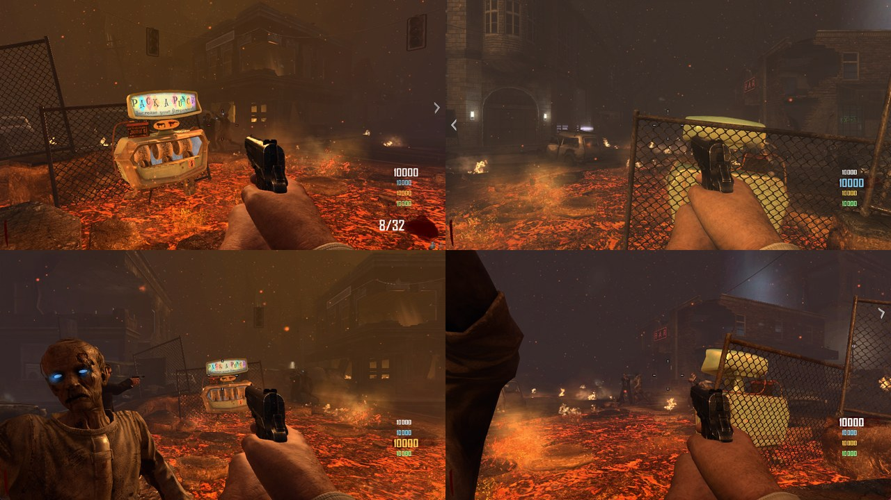
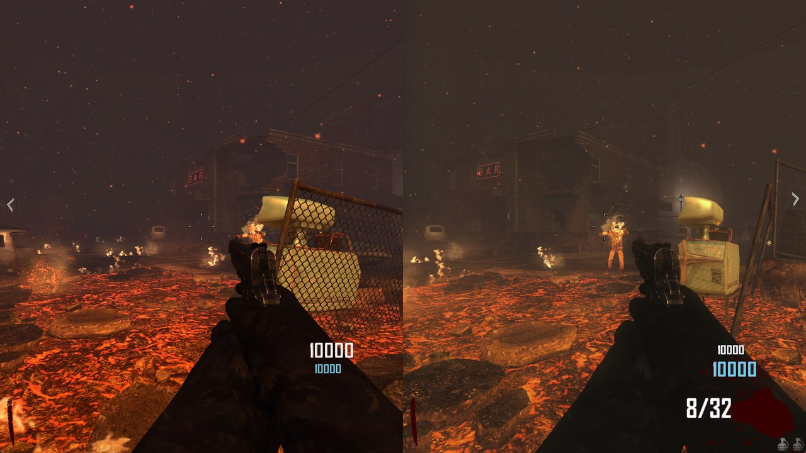
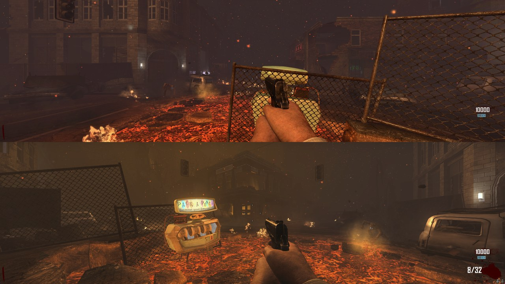

# bo2split

**Local split-screen for Call of Duty: Black Ops II Zombies on PC. Up to four players, one screen, one running game.**

-orange)
-lightgrey)

[Install](#install) · [Start a match](#start-a-match) · [Controls](#controls) · [Settings](#settings) · [Known limits](#known-limits) · [How it works](#how-it-works)

---

The PC version of Black Ops II never shipped the split-screen the consoles had. bo2split adds it: a single replacement `XINPUT1_3.dll` in the game folder, no second game instance, no second account, no window juggling. Plug in the gamepads, press A in the lobby, play.

> **Offline and local only.** The mod acts only while the Steam client is in offline mode; while Steam is online it refuses to change anything. Nothing is sent to any server, and there is no online play with it. It is for playing at one screen with friends.

## Features

| | |
|---|---|
| **2 to 4 players** | Two halves (side by side or top and bottom), three players as one wide view above two quarters or as three quarters, four quarters. A player who is alone gets the whole screen. |
| **One game instance** | Players 2 to 4 are real clients inside the same process, connected to the game's own local server. One window, one copy of the game in memory. |
| **A full view per player** | Own camera, first-person weapon, HUD (points, ammo, round, collected parts, power-up icons), scoreboard and sound listener. Sound is worked out per player, as on the console split screen. |
| **Any mix of devices** | Up to four XInput gamepads, or keyboard and mouse for one player and gamepads for the others. |
| **Join in the lobby** | The game's own local lobby opens by itself. Choose the map there; players join with A and leave with B. |
| **The whole move set** | Players 2 to 4 shoot, aim, reload, sprint, crouch, go prone, dive to prone, switch weapons, throw grenades, use the action slots, buy perks, and build with parts. |
| **Options per player** | Start on a gamepad opens the game's controller options in that player's own view: look sensitivity, inversion, stick layout, button layout, vibration. Kept per player; the match goes on meanwhile. |
| **Gamepad feel of the game** | The right stick of every player uses the game's own response curve and turn rates, and the turn rate no longer depends on the number of views. The run-up of the turn can be switched off (`look_accel`). |
| **Vibration per player** | Each gamepad vibrates for its own player's shots, hits and explosions. |
| **Settings window** | `panel.bat` edits every setting, shows the live state of each pad and assigns a device by pressing a button on it. Most settings apply while the game runs. |

### Screen layouts

| Two players, side by side | Two players, top and bottom |
|---|---|
|  |  |

| Three players | Four players |
|---|---|
|  |  |

The split direction is `split_vertical`, the layout with three players `layout_three_players` (one wide view above two quarters, as shown, or three quarters).

## Supported game build

| | |
|---|---|
| Game | Call of Duty: Black Ops II, Zombies (`t6zm.exe`) |
| Distribution | Steam (PE timestamp of the executable: `0x6a8332d9`) |
| Architecture | 32-bit, Direct3D 11 |
| Maps played | TranZit (story), Survival on Town, Farm, Diner and Bus Depot, Origins from the installed DLC |
| Other executables | Not supported. The mod reads the executable's timestamp at start; with any other build it writes that into its log and changes nothing. |

The mod hooks the engine at fixed addresses, so it is tied to this one build. An update of the game needs an update of the mod.

## Requirements

- Windows with the Steam version of Black Ops II (`t6zm.exe`). The mod recognises one game build; with any other executable it logs that and changes nothing.
- The Steam client in offline mode.
- For players 2 to 4: an XInput gamepad each, or keyboard and mouse for one of them. Player 1 plays on the first connected gamepad, or on keyboard and mouse when none is connected.
- To build the DLL yourself: Visual Studio Build Tools with the C++ workload (the build is 32-bit). You do not need this to use a release.

Requirements beyond those of the game itself have not been measured.

## Install

1. Put Steam into offline mode (Steam menu, "Go Offline").
2. Copy `XINPUT1_3.dll` and `bo2ss.ini` into the game folder, next to `t6zm.exe`. In the Steam library: right click the game, Manage, Browse local files.
3. Optional: copy `panel.ps1` and `panel.bat` there too, for the settings window.

To remove the mod, delete `XINPUT1_3.dll` from the game folder.

The mod writes `bo2ss.log` into the same folder. It is the file to attach to a bug report.

## Start a match

1. Start Black Ops II Zombies from Steam while Steam is in offline mode.
2. The local lobby opens by itself after a moment. Do not click "Online".
3. Choose the map in the lobby (Map, then game mode and location).
4. Other players join in the lobby: press A on a gamepad that no player uses yet. The lobby lists each player and shows a line saying which player joins next. B on a joined pad leaves again. Player 1 is always in: it has the first connected gamepad, or the keyboard and mouse when no gamepad is connected, and its device cannot join or leave. While player 1 plays on a gamepad, keyboard and mouse still work in the menus. If nobody joins, player 1 plays alone on the whole screen.
5. Start the match by hand with "Start Match".

The map choice shows only the base game's map. A map from a DLC that you own and have installed can still be played: name it in `bo2ss.ini` with the settings `map`, `startlocation` and `gametype` (`zm_transit`, `transit`, `zclassic` for TranZit; `zm_tomb`, `tomb`, `zclassic` for Origins; the combinations that have been played are listed in [docs/configuration.md](docs/configuration.md#start)), and start the match from the lobby.

## Controls

Player 1 plays through the game's own bindings, on keyboard and mouse or on a gamepad. Players 2 to 4 use the layouts below. Their pad layout is shared by the three players and can be changed with the `btn_*` settings (see Settings).

### Gamepad, players 2 to 4

| Input | Action |
|---|---|
| Left stick | Move |
| Right stick | Look |
| Right trigger | Fire |
| Left trigger | Aim down sights |
| Right bumper | Lethal grenade |
| Left bumper | Tactical grenade |
| X | Use / reload |
| A | Jump (stands up first when crouched or prone) |
| B | Crouch (tap), prone (hold) |
| Left stick click | Sprint |
| Right stick click | Melee |
| Y | Next weapon |
| D-pad up, down, left, right | Action slots 1 to 4 |
| Start | The player's own controller options |
| Back | Scoreboard in the player's own view, while held |

Sprinting and then holding the crouch button dives to prone. A press of the sprint button while crouched or prone stands the player up.

Start opens the game's controller options for that player, inside the player's own view: look inversion, stick layout, button layout and look sensitivity. D-pad or left stick moves, A selects, B goes back, Start closes. The match goes on meanwhile and the other players see nothing of it. The choices are kept per player in `bo2ss_players.ini` in the game folder. A button layout chosen there (tactical, lefty, N0M4D, charlie) changes which button does what on top of the table above. Player 1 uses the game's own pause and options menu.

### Keyboard and mouse, players 2 to 4

This layout is fixed. Only one player at a time can have the keyboard and mouse; while a player 2 to 4 has them, they no longer reach player 1.

| Input | Action |
|---|---|
| W A S D | Move |
| Mouse | Look |
| Left mouse button | Fire |
| Right mouse button | Aim down sights |
| G | Lethal grenade |
| Q | Tactical grenade |
| F or R | Use / reload |
| Space | Jump |
| C or left Ctrl | Crouch (tap), prone (hold) |
| Left Shift | Sprint |
| V or E | Melee |
| 1 or middle mouse button | Next weapon |
| 2 | Previous weapon |
| 3, 4, 5, 6 | Action slots 1 to 4 |
| Escape | Pause menu of player 1 |

## Settings

The settings live in `bo2ss.ini` in the game folder. Each setting has a comment, and a setting that is left out has its default. The mod reads most of them every frame, so a change shows while the game runs. The ones you are most likely to look for: `lobby_join`, `auto_start_after_ms`, `map`, `startlocation` and `gametype` (start), `p1_pad` to `p4_pad` and `extra_players` (devices), `split_vertical`, `layout_three_players` and `fov_scale` (screen), `look_native`, `look_speed`, `look_deadzone`, `look_curve`, `look_ads_scale` and `mouse_sens` (look and aim), the `btn_*` keys and `stance_hold_ms` (buttons) and `trace` (log).

The settings window `panel.bat` edits the same file. Double click it from the game folder. It finds the game folder itself. `panel.bat` starts a PowerShell script with the execution policy set for that one call only, because Windows would otherwise refuse to run an unsigned script; the script is plain text next to it and you can read it first. The window has tabs for:

- the input device of each player, chosen from a list or by pressing a button on the device, with the live state of each pad;
- the button layout of the gamepad and the stance hold time;
- look and aim: stick speed, dead zone, response curve, turn rate while aiming, mouse speed;
- the screen: split direction, layout with three players, field of view;
- the start: map, start location, game type, automatic start or lobby by hand, joining in the lobby;
- the end of the log.

Every setting is described in [docs/configuration.md](docs/configuration.md). For a bug report, attach `bo2ss.log` and your `bo2ss.ini`; [docs/diagnostics.md](docs/diagnostics.md) says how to read the log and lists the switches that are not in the file.

## Known limits

- The controller options of players 2 to 4 show one row that does nothing for them: "Enable gamepad" (skipped). With two views side by side the options are drawn at half size.
- Players 2 to 4 cannot open the pause menu (resume, restart, end game); that stays with player 1.
- The keyboard and mouse layout of players 2 to 4 is fixed, and the hint texts in their halves show player 1's key names.
- Burning and some other effects the server tells players 2 to 4 about are not shown on their screens.
- Players 3 and 4 start to aim down sights a little later than player 2 does, because the aim is not predicted locally for them.
- Stance changes of players 2 to 4 start a little later than player 1's.
- The muzzle flash can sit beside the weapon in some views.
- Whether a gamepad vibrates is up to the pad and its connection: the mod sends the motor values to every pad, and some pads ignore them over Bluetooth.
- Switching the layout (three players, split direction) during a match leaves the HUD at the old place. Choose the layout before the match starts.
- The hint line in the lobby is placed for a 16:9 screen; other aspect ratios are not tested.
- The names of the joined players in the lobby are the host's name and a number.
- Not yet tested: player 1 on a gamepad in the lobby, unplugging a gamepad in the lobby, joining right after a game over without going back to the main menu.

## Build from source

Run `build.bat` from a normal command prompt. It looks for the Visual Studio Build Tools, compiles every source file under `src\` as a 32-bit DLL and writes `build\XINPUT1_3.dll`. Copy it and `bo2ss.ini` as described under Install. See [CONTRIBUTING.md](CONTRIBUTING.md) for the layout of the code.

## How it works

The DLL stands in for the game's XInput library, so the game loads it at start and calls it every frame. From that call it runs a second, third and fourth client of the game inside the same process. They connect to the game's own local server through a loopback connection, so the server sees four players. The screen is drawn with the engine's own view loop, once per player, into a part of the screen each. Each pass runs on a copy of the engine's per-player state, so every player has their own camera, weapon, HUD and sound. The design is described in [docs/how-it-works.md](docs/how-it-works.md).

## Disclaimer and licence

bo2split is not affiliated with or endorsed by Activision or Treyarch. Call of Duty and Black Ops are trademarks of their owners; the game's name is used here only to say what the mod is for. You need your own copy of the game. The repository contains no game files, and none may be contributed to it.

The code is released under the MIT licence, see [LICENSE](LICENSE). The mod is provided as it is, without any warranty. Use it at your own risk and only with a game you own.
