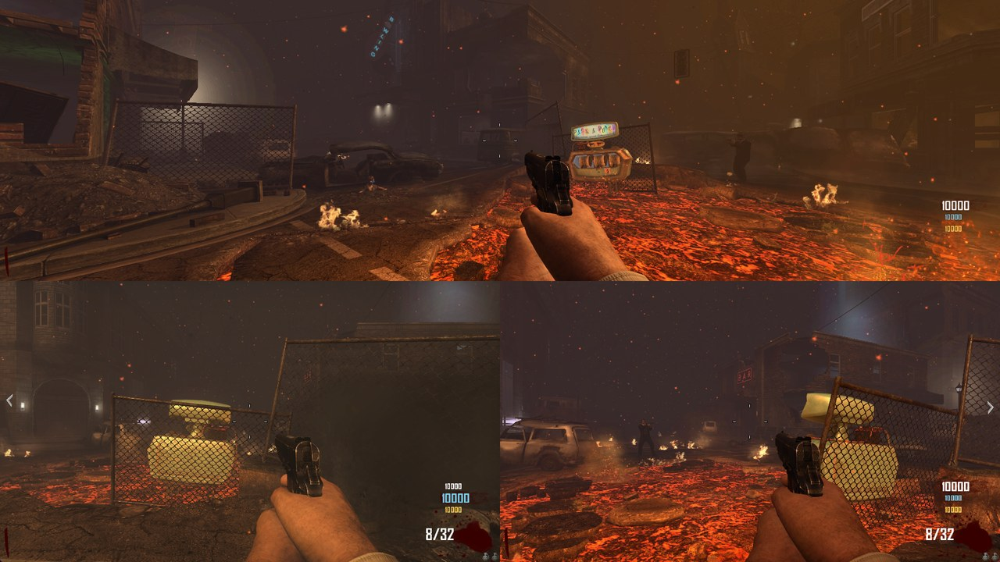
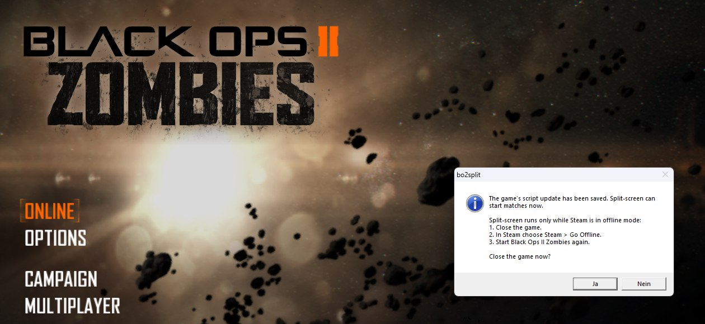
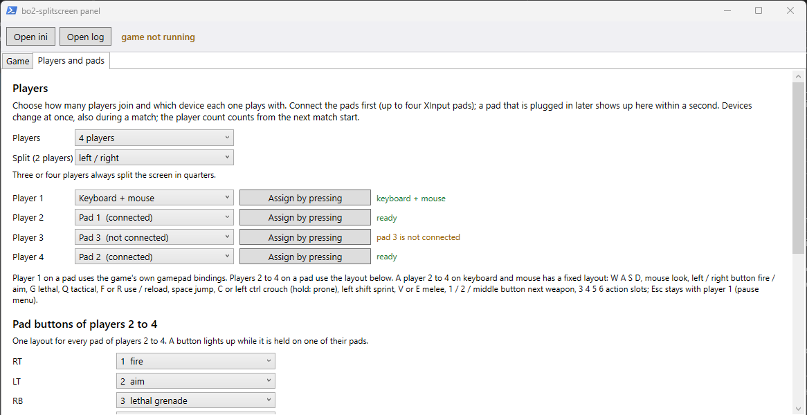

# bo2split

**Local split-screen for Call of Duty: Black Ops II Zombies on PC. Up to four players, one screen, one running game.**

-orange)
-lightgrey)

[Install](#install) · [Start a match](#start-a-match) · [Settings and controls](#settings-and-controls) · [Known limits](#known-limits) · [How it works](#how-it-works) · [Changes](CHANGELOG.md)

---

The PC version of Black Ops II never shipped the split-screen the consoles had. bo2split adds it: a single replacement `XINPUT1_3.dll` in the game folder, no second game instance, no second account, no window juggling. Plug in the gamepads, press A in the lobby, play.

> **Offline and local only.** The mod acts only while the Steam client is in offline mode. While Steam is online it changes nothing in the game: no patch, no hook; it only saves the game's script update to the game folder (see [Install](#install)). Nothing about you or the game is sent to any server, and there is no online play with it. The only request the mod makes is one to GitHub at the start of the game, to ask whether a newer release is out; `update_check=0` in `bo2ss.ini` switches it off. It is for playing at one screen with friends.

## Features

| | |
|---|---|
| **2 to 4 players** | Two halves (side by side or top and bottom), three players as one wide view above two quarters or as three quarters, four quarters. A player who is alone gets the whole screen. |
| **One game instance** | Players 2 to 4 are real clients inside the same process, connected to the game's own local server. One window, one copy of the game in memory. |
| **A full view per player** | Own camera, first-person weapon, HUD (points, ammo, round, collected parts, power-up icons), scoreboard and sound listener. Sound is worked out per player, as on the console split screen. |
| **Any mix of devices** | Up to four XInput gamepads, or keyboard and mouse for one player and gamepads for the others. |
| **Join in the lobby** | The game's own local lobby opens by itself. Choose the map there; players join with A and leave with B. |
| **The whole move set** | Players 2 to 4 shoot, aim, reload, sprint, crouch, go prone, dive to prone, switch weapons, throw grenades, use the action slots, buy perks, and build with parts. |
| **Options per player** | Start on any gamepad pauses the match; every player 2 to 4 then has the game's controller options in its own view: look sensitivity, inversion, stick layout, button layout, vibration. Kept per player. |
| **Gamepad feel of the game** | The right stick of every player uses the game's own response curve and turn rates, and the turn rate no longer depends on the number of views. The run-up of the turn can be switched off (`look_accel`). |
| **Vibration per player** | Each gamepad vibrates for its own player's shots, hits and explosions. |
| **Settings window** | `panel.bat` edits every setting, shows the live state of each pad and assigns a device by pressing a button on it. Most settings apply while the game runs. |

### Screen layouts

| Two players, side by side | Two players, top and bottom |
|---|---|
|  |  |

| Three players | Four players |
|---|---|
|  |  |

The split direction is `split_vertical`, the layout with three players `layout_three_players` (one wide view above two quarters, as shown, or three quarters).

## Install

1. Copy `XINPUT1_3.dll` and `bo2ss.ini` into the game folder, next to `t6zm.exe`. In the Steam library: right click the game, Manage, Browse local files.
2. Get the game's script update, once (see below). **Without it no match starts.**
3. Put Steam into offline mode (Steam menu, "Go Offline").
4. Optional: copy `panel.ps1` and `panel.bat` into the game folder too, for the settings window.

To remove the mod, delete `XINPUT1_3.dll` from the game folder.

### The script update (needed once)

**What it is.** Black Ops II does not keep all of its Zombies scripts on disk. The rest is in a small file the developers called the "fix of the day" (`ffotd_tu17_zm_147.ff`, 72 KB). They used it to change scripts without a full game update. It carries the core script of the game mode (`_globallogic.gsc`) and three fixes for Origins.

**Why it is needed.** The game downloads this file into memory every time it starts while Steam is online, and it is gone when the game closes. In offline mode the game never gets it, and a match then stops at the start with a script error (`Unresolved external: 'checkscorelimit'`). Split-screen runs in offline mode, so the file has to be on disk: the mod loads it from the folder `zone\all\` of the game. It is the game's own file, unchanged, and it is needed only once.

There are two ways to put it there.

**A. Let the game fetch it.** With the mod installed, start Black Ops II Zombies once while Steam is **online**. A few seconds after the start, when the game has fetched the file, the mod writes it to `zone\all\ffotd_tu17_zm_147.ff` and shows a message. Close the game, go offline in Steam, start again.

> **About going online with the mod in the game folder.** While Steam is online the mod changes nothing in the game: no patch, no hook, it only reads the downloaded file from memory and writes it to disk. Still, the game then runs online with a DLL in its folder that is not part of the game, and Black Ops II is protected by VAC. Nobody can promise what an anti-cheat system makes of that. If you do not want to take that risk, which is understandable, use way B: it never starts the game online with the mod.

**B. Download it, without going online.** The Plutonium project hosts the same file: <https://cdn.plutoniummod.com/updater/prod/files/ea85be352df0b4d029c4e406ae8d6beec1dcf10c>. Save it as `ffotd_tu17_zm_147.ff` in the folder `zone\all\` of the game. To check the download: its SHA-256 is `347ab6bd03af40fbe32bd0b7aa60c80671227b5ab25c6da7178f6e996a7b2e5f` (in PowerShell: `Get-FileHash ffotd_tu17_zm_147.ff`). The address belongs to another project and may change.

If the file is missing in offline mode, the mod says so in a message at the start, offers to open this section in the browser, and does not open the lobby. Background: [issue #7](https://github.com/pndevo/bo2split/issues/7).

The mod writes `bo2ss.log` into the same folder. It is the file to attach to a bug report.

## Start a match

1. Start Black Ops II Zombies from Steam while Steam is in offline mode.
2. The local lobby opens by itself after a moment. Do not click "Online".
3. Choose the map in the lobby (Map, then game mode and location).
4. Other players join in the lobby: press A on a gamepad that no player uses yet, B leaves again. Player 1 is always in, on the first connected gamepad or on keyboard and mouse when there is none. If nobody joins, player 1 plays alone on the whole screen.
5. Start the match by hand with "Start Match".

The map choice shows only the base game's map. A DLC map that you own and have installed is named in `bo2ss.ini` instead, see [docs/configuration.md](docs/configuration.md#start).

## Supported game build

| | |
|---|---|
| Game | Call of Duty: Black Ops II, Zombies (`t6zm.exe`) |
| Distribution | Steam (PE timestamp of the executable: `0x6a8332d9`) |
| Architecture | 32-bit, Direct3D 11 |
| Maps played | TranZit (story), Survival on Town, Farm, Diner and Bus Depot, Origins from the installed DLC |
| Other executables | Not supported. The mod reads the executable's timestamp at start; with any other build it writes that into its log and changes nothing. |

The mod hooks the engine at fixed addresses, so it is tied to this one build. An update of the game needs an update of the mod.

## Requirements

- Windows with the Steam version of Black Ops II (`t6zm.exe`). The mod recognises one game build; with any other executable it logs that and changes nothing.
- The Steam client in offline mode.
- For players 2 to 4: an XInput gamepad each, or keyboard and mouse for one of them. Player 1 plays on the first connected gamepad, or on keyboard and mouse when none is connected.
- To build the DLL yourself: Visual Studio Build Tools with the C++ workload (the build is 32-bit). You do not need this to use a release.

Requirements beyond those of the game itself have not been measured.

## Settings and controls

Everything works without touching a setting. To change one, start **`panel.bat`** in the game folder. It opens a settings window:

- The device of each player, chosen from a list or by pressing a button on it, the number of players and the split direction.
- The action of each gamepad button of players 2 to 4.
- Look and aim, screen layout, map and start.

Most changes apply while the game runs. The window edits `bo2ss.ini` in the game folder; each setting there has a comment, and a setting that is left out has its default.

In a match, Start on the gamepad of a player 2 to 4 opens the game's own controller options in that player's view: look sensitivity, look inversion, stick layout and button layout, each player with values of its own. Player 1 uses the game's options as always.

The default layout of players 2 to 4 is the one of the console version. The tables, also for keyboard and mouse, are in [docs/controls.md](docs/controls.md); every setting is described in [docs/configuration.md](docs/configuration.md).

## Known limits

- The controller options of players 2 to 4 show one row that does nothing for them: "Enable gamepad" (skipped). With two views side by side the options are drawn at half size.
- Players 2 to 4 pause the match with Start, but the entries of the pause menu (resume, restart, end game) are player 1's.
- The menu of a player 2 to 4 has a darker background than player 1's.
- The keyboard and mouse layout of players 2 to 4 is fixed, and the hint texts in their halves show player 1's key names.
- Players 3 and 4 start to aim down sights a little later than player 2 does, because the aim is not predicted locally for them.
- Stance changes of players 2 to 4 start a little later than player 1's.
- In split-screen no shell casings fly from a player's own first-person weapon.
- Whether a gamepad vibrates is up to the pad and its connection: the mod sends the motor values to every pad, and some pads ignore them over Bluetooth.
- Switching the layout (three players, split direction) during a match leaves the HUD at the old place. Choose the layout before the match starts.
- The hint line in the lobby is placed for a 16:9 screen; other aspect ratios are not tested.
- The names of the joined players in the lobby are the host's name and a number.

Found something else? Open an issue with the bug report form; it asks for `bo2ss.log` and `bo2ss.ini`. [docs/diagnostics.md](docs/diagnostics.md) says how to read the log.

## Build from source

Run `build.bat` from a normal command prompt. It looks for the Visual Studio Build Tools, compiles every source file under `src\` as a 32-bit DLL and writes `build\XINPUT1_3.dll`. Copy it and `bo2ss.ini` as described under Install. See [CONTRIBUTING.md](CONTRIBUTING.md) for the layout of the code.

## How it works

The DLL stands in for the game's XInput library, so the game loads it at start and calls it every frame. From that call it runs a second, third and fourth client of the game inside the same process. They connect to the game's own local server through a loopback connection, so the server sees four players. The screen is drawn with the engine's own view loop, once per player, into a part of the screen each. Each pass runs on a copy of the engine's per-player state, so every player has their own camera, weapon, HUD and sound. The design is described in [docs/how-it-works.md](docs/how-it-works.md).

## Changes

See [CHANGELOG.md](CHANGELOG.md).

## Disclaimer and licence

bo2split is not affiliated with or endorsed by Activision or Treyarch. Call of Duty and Black Ops are trademarks of their owners; the game's name is used here only to say what the mod is for. You need your own copy of the game. The repository contains no game files, and none may be contributed to it.

The code is released under the MIT licence, see [LICENSE](LICENSE). The mod is provided as it is, without any warranty. Use it at your own risk and only with a game you own.
